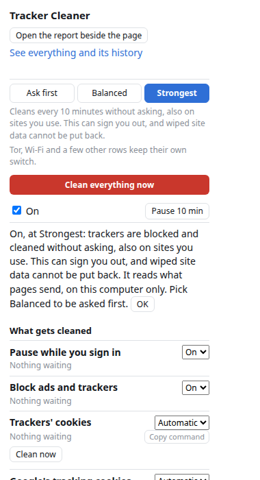

# Tracker Cleaner

A Chrome extension that stops companies from following you between websites, and shows you what it did.
It runs entirely on your computer: no account, no server, nothing sent anywhere.

What it does by itself on a new install:

- it blocks requests to known trackers, and strips tracking tags from links;
- it deletes tracking cookies, and clears the saved copies of pages once a day and each time Chrome starts;
- when a page asks another company for something, it removes your cookies, cache tags and the referring page
  from that request;
- it stops pages from calling programs on this computer or devices on your home network;
- it runs a small script in every page that blurs what makes your browser recognisable and takes the
  "notify" address off links you press;
- to spot trackers that are on no list, it reads the addresses and contents of what pages send, in memory, on
  this computer only.

A company on no list is only ever asked about, unless you choose Strongest, where the cleaner answers yes for
you. Strongest can also hit sites you use: when other sites ask it for things and it answers with a cookie other
sites can use, it is blocked there and what it saved is emptied. That can sign you out, and emptied site data
cannot be put back.

## Install

There is no store listing; you load the folder.

1. Download or clone this repository.
2. Open `chrome://extensions` and switch on **Developer mode** (top right).
3. Press **Load unpacked** and choose the `extension/` folder.
4. Open the popup from the toolbar. It should say version 1.32.

To update, pull the new files and press the reload arrow on the extension's card. Only a fresh install starts
at Strongest; an update keeps your settings.

## Choose how strong

The control at the top of the popup sets every row at once.

| Position | What happens without a press | Cost |
|---|---|---|
| **Ask first** | Known trackers stay blocked. Nothing is deleted until you press. | You answer everything yourself. |
| **Balanced** | Known trackers and what they saved are cleaned. Codes seen on two sites are cut. Companies on no list wait for your answer. | A few questions now and then. |
| **Strongest** (new install) | Everything is cleaned every 10 minutes, and every question is answered yes. | Pages load slower. It can sign you out of a site you use, and wiped site data cannot be put back. |

Every row also has its own switch, and **Clean now**. **Clean everything now** at the top runs every row once;
if questions are waiting it names the sites first.

## Undo

- **A deleted cookie**: Undo, for 10 minutes.
- **A blocked or skipped company**: "Let it through". It then stays let through, for that whole site.
- **One site misbehaves**: "Don't clean on this site" in the popup. The cleaner then leaves it alone completely.
- **Everything**: untick "On", or "Pause 10 min".
- **Not undoable**: emptied site data, cleared saved copies, a forgotten Wi-Fi network, cleared history. The
  popup says so before each.

Cookies that keep you signed in are never deleted, sign-in pages of Google, Microsoft and Apple are never
touched, and nothing is deleted while you are signing in.

## What it stops, measured

The repository contains a test lab: a pretend social network that follows a visitor in 36 ways, and a second
tracker that hides behind each site's own address. A real Chrome walks through both with the cleaner installed.
Of the 35 ways that were built, still following you at the end:

| Setting | Still following you |
|---|---|
| Cleaner off | 35 |
| Balanced, no press | 25 |
| Strongest, no press | 7 |
| Any setting, every question answered yes | 5 |

Against the hidden tracker the cleaner stops 6 of 10 ways, after the first contact.
The full list, one row per way: [docs/scorecard.md](docs/scorecard.md).

## What it cannot stop

- **Anything that never passes your browser.** A shop's server telling a tracker what you bought or the e-mail
  address you typed. Use a different e-mail address per site.
- **Your own press.** "Sign in with ...", or a Like on the tracker's own site.
- **The first contact.** A tracker on no list is recognised only once it has been seen on two sites.
- **A tracker that hides behind the site's own address** and adapts: 4 of 10 ways get through in the lab, and
  one that encodes its code differently on every site would evade the rest.
- **Your network address.** Only the optional Tor row hides it.

Known weak spots, found by adversarial review and left open on purpose:

- At Strongest, a hostile page or ad can stage the evidence that makes the cleaner block and empty a site you
  use, at most 10 an hour. "Let it through" stops it for that site. Balanced only asks.
- At every setting, a page can in narrow cases get a site's own search or API address blocked for you, when
  that site forwards a value the page chose. "Don't clean on this site" undoes it.
- The fingerprint blur is best effort; a determined site can undo it.

## Privacy

- Nothing leaves your computer. The only network calls are to `127.0.0.1`, for the optional report and Tor
  rows, and one check at `check.torproject.org` when you press its button.
- It needs to see every request to recognise trackers. What it reads stays in memory; site names are stored
  only as salted hashes, except for sites it blocked or you answered about.
- The log of what was removed holds cookie names and counts, never what a cookie contained.

## For developers

    npm test              # 808 unit tests, Node 22, no packages, no browser
    npm run test:lab      # the lab walk with the cleaner off (needs google-chrome)
    node test/lab/trip-cleaner.js   # the same walk with the cleaner on
    node test/lab/ff2-trip.js       # the hidden-collector tracker

- `extension/` the extension. `background.js` is the service worker; `registry.js` holds the rows, the
  strength levels and the one gate every action passes.
- `security/trackers.js` the lists, edited by hand; `node extension/build.js` regenerates the rule files.
- `lab/` the test trackers. `test/` the tests, with a stand-in for the `chrome` API.
- `extension-1.20/` an old version the tests compare against.
- `wifi-helper/` an optional local program for the Wi-Fi row.
- [docs/rows.md](docs/rows.md) what each row does, in full. [docs/tools.md](docs/tools.md) the command that
  reads Chrome's own files, the report panel and the Wi-Fi helper. `PLAN.md` the build log, including every
  audit finding.

`git.sh` and a few test helpers contain paths from the author's machine; adjust them or use plain `git`.

## Licence

MIT. See `LICENSE`.
